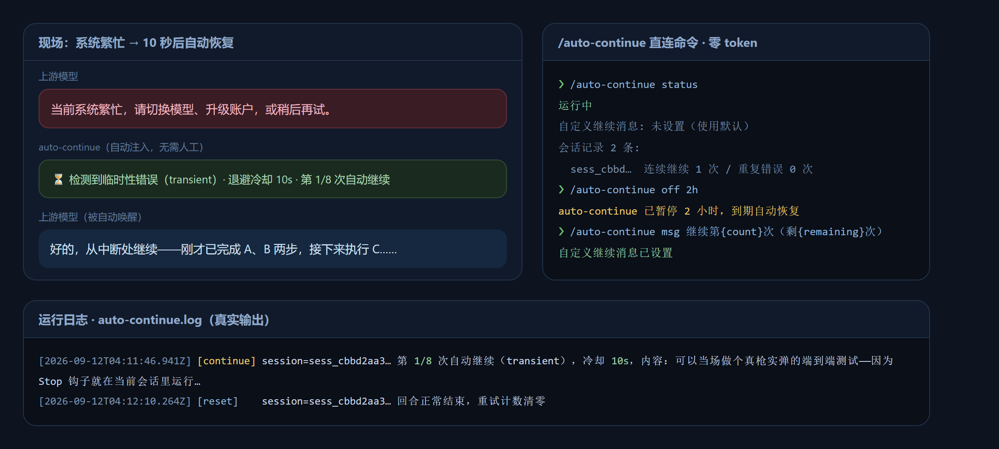
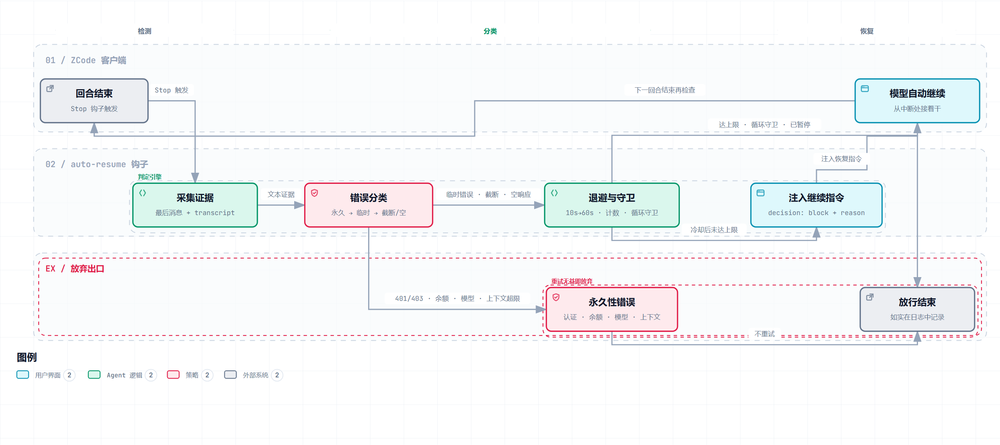

<p align="center">
  <picture>
    
  </picture>
</p>

<h2 align="center">zcode-revive</h2>

<p align="center">
  <em>ZCode plugin — when a turn dies with "system busy" and other transient errors, it automatically says "continue" for you.</em>
</p>

<p align="center">
  <a href="README.md">中文</a> · <a href="README.en.md">English</a>
</p>

<p align="center">
  <a href="LICENSE"></a>
  =0.16">
  
  
  =18">
  
  <a href="https://github.com/nineaiyu/zcode-revive/releases"></a>
  
  <a href="https://github.com/nineaiyu/zcode-revive/pulls"></a>
</p>

---

Turns ZCode's most annoying free-tier failure — "**The system is busy. Switch models, upgrade your account, or try again later.**" — into automatic recovery: when a dies from a transient fault, the plugin injects a continuation via the Stop hook so the agent keeps working unattended. Inspired by [dsh-auto-continue](https://github.com/HsiangNianian/dsh-auto-continue), rebuilt on the ZCode Hooks contract with field-tested details from [dustinmoon78/zcode-auto-continue](https://github.com/dustinmoon78/zcode-auto-continue) and [chr431/zcode-plugin-auto-continue](https://github.com/chr431/zcode-plugin-auto-continue).

<p align="center">
  
</p>

## What it does

| Situation | Behavior |
| --- | --- |
| System busy / 429 / 5xx / overloaded | ⏳ **Auto-continue** after adaptive backoff |
| Timeout / network error / dropped connection | ⏳ Auto-continue |
| Truncated reply (unclosed code fence, trailing ellipsis) | ✂️ Resume with "continue output, don't repeat" |
| Empty response | 🔁 Retry with "please reply normally" |
| Auth failure / no balance / unknown model / context overflow | 🛑 Give up (retrying won't help) |
| Normal completion / user-initiated stop | ✅ Hands off, retry counters reset |

**Built-in recovery:** error classification (permanent errors detected first and skipped) · adaptive backoff (10s→20s→40s… capped at 60s) · retry cap and loop guard · double false-positive protection (long messages must end with an error banner + keyword coverage threshold + user-discussion detection) · dual field-name compatibility (ZCode camelCase / Claude Code snake_case) · logging and debug dumps.

### Recovery flow

<p align="center">
  
</p>

The Stop hook collects evidence at turn end and classifies it: transient errors pass through backoff and guards before a continuation is injected, letting the model pick up where it died; permanent errors and exhausted budgets are honestly released. The diagram was generated by [archify](https://github.com/tt-a1i/archify) and passed showcase-level validation — interactive version at [docs/recovery-flow.html](docs/recovery-flow.html), authored spec at [docs/recovery-flow.workflow.json](docs/recovery-flow.workflow.json).

## Install

Requires local `node` ≥ 18 on PATH.

> [!TIP]
> **Easiest install (beginners)**: paste this straight into ZCode and let it handle everything:
>
> ```text
> Please install this plugin for me: https://github.com/nineaiyu/zcode-revive
> ```

Manual steps:

1. ZCode → **Settings → Plugin Management → Discover**, click **+** to add a marketplace from **GitHub repo** `nineaiyu/zcode-revive` (or pick **local directory** after downloading).
2. Install and enable `zcode-revive`, restart your session.
3. Type `/revive status` — "running" means you're set.

## /revive command

Intercepted directly by the UserPromptSubmit hook — **no model call, zero tokens**:

| Command | Effect |
| --- | --- |
| `/revive status` | Run state, session counters, custom message |
| `/revive on` / `off [duration]` | Toggle; timed expiry auto-resumes (`45s / 30m / 2h / 1d`, bare numbers = minutes) |
| `/revive msg <text>` | Custom continuation with `{count}` `{remaining}` `{message}` placeholders; `msg clear` resets |

## Known limits & client patches

For the free Start Plan, the banner "当前系统繁忙…" kills the turn via `turn.failed`, which fires **no hooks at all** (an architectural blind spot of the hook system). Root cause confirmed in 0.2.1: the banner hides an SSE stream error `model concurrency limit exceeded` (GLM error code 1302 family), while the client's turn-level retry gate only accepts error codes {3008, 3009, 3010} — concurrency codes aren't whitelisted and the error often carries no parseable numeric code, so the turn fails with **zero retries**. [`scripts/patch-retry-table.mjs`](scripts/patch-retry-table.mjs) fixes all three angles:

1. adds 1302 / 1303 / 1305 (concurrency limit codes) to the retry whitelist;
2. adds a message-based fallback to the turn-level retry gate: any error in the cause chain whose message matches `concurrency / busy / overload / 繁忙` is retryable (covers the no-code case);
3. retry delay becomes **random 3–13 seconds per retry** (cap: 10 *consecutive* failures, replacing the fixed backoff table);
4. the adapter-level error classifier gets the same message-based fallback marking `retryable=true` — background model requests that never go through the main turn loop (session hydration; the error dialog shows TraceID `hydrate-trace`) only pass through this classifier, and without the patch concurrency errors still fail with zero retries there;
5. **the retry counter resets on any successful model request** — officially it accumulates for the whole turn (retry 3×, succeed, then fail again later and only 7 retries remain); with the reset the cap truly counts 10 consecutive failures.

```bash
node scripts/patch-retry-table.mjs apply    # reversible, idempotent, backs up zcode.cjs
```

Same blind spot, different path: when a model request dies at the transport layer with `write EPIPE` (connection severed by the peer), the client's failure classifier omits EPIPE from its network-error whitelist, so the error is marked `retryable=false` and the turn fails with zero retries (hooks can't intervene either). [`scripts/patch-epipe-retryable.mjs`](scripts/patch-epipe-retryable.mjs) inserts EPIPE into that whitelist so it retries like its `ECONNRESET` siblings, using the client's own backoff:

```bash
node scripts/patch-epipe-retryable.mjs apply  # reversible, idempotent, backs up zcode.cjs
```

Local plugin icons are refused by the settings UI (its guard only accepts `https://`); [`scripts/patch-icon-src.mjs`](scripts/patch-icon-src.mjs) does an in-place equal-length patch to also allow `data:image/`:

```bash
node scripts/patch-icon-src.mjs apply       # fully quit ZCode first
```

All three patches are overwritten by ZCode upgrades — re-run `apply` afterwards; `status` to inspect, `revert` to undo. The scripts auto-detect common install locations; if not found, set `ZCODE_CJS_PATH` / `ZCODE_ASAR_PATH` or create `scripts/.local-paths.json` (gitignored) with your local paths.

### Works great with the native goal mode `/goal`

ZCode ships a built-in goal loop: `/goal <objective>` verifies progress after every turn and keeps injecting "continue" until the objective is done (`/goal pause|resume|clear` to manage; goals auto-pause when you stop the session). It complements this plugin: **the goal loop handles "work not finished", this plugin handles "turns killed by faults"**. Note the goal loop has no failure-retry of its own — if a turn fails the goal stays active and a single "continue" (or `/goal resume`) re-engages it instantly.

## Configuration & troubleshooting

> [!IMPORTANT]
> **A red "Model request failed." banner ≠ broken plugin.** That banner means the turn *failed* (`turn.failed`) — ZCode fires **no hooks** on this path, so the plugin cannot act (architectural blind spot, see above). It's usually local network / proxy flakiness or server-side congestion: the retry patch already auto-retries inside the client (random 3–13 s per retry; gives up only after 10 consecutive failures, and any successful request resets the streak); if it still fails, just send "continue" manually to pick up.
>
> **How to verify the plugin is fine**: click the anchor icon next to the input box to inspect hook timings (green = healthy), or run `/revive status` and look for "running".

A `config.json` in the data directory (`$ZCODE_PLUGIN_DATA`) overrides any default (backoff, caps, recovery texts, pattern tables, `debug` raw-input dumps) — see the fully commented [hooks/revive.mjs](hooks/revive.mjs). Logs live next to it as `revive.log`.

| Symptom | Fix |
| --- | --- |
| Hooks not firing | Confirm both hooks show runnable on the plugin detail page; check ZCode logs |
| See what the hook receives | Set `"debug": true` in config, read `last-input.json` in the data dir |
| Wrongly continues / misses | Tune `permanentPatterns` / `transientPatterns` / `minErrorCoverage` |

## Credits & license

- [dsh-auto-continue](https://github.com/HsiangNianian/dsh-auto-continue) (MIT) — classification & backoff ideas
- [dustinmoon78/zcode-auto-continue](https://github.com/dustinmoon78/zcode-auto-continue) — truncation/empty-response recovery, stdin field findings
- [chr431/zcode-plugin-auto-continue](https://github.com/chr431/zcode-plugin-auto-continue) — direct command & timed toggles

Code released under [MIT](LICENSE). Unofficial plugin, not affiliated with Z.ai; use at your own risk.

<p align="center">
  <sub>Let the machine wait out "system busy" — you just keep asking.</sub>
</p>
